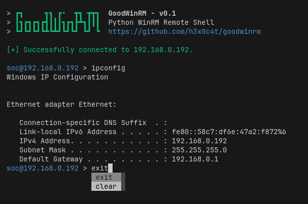

# GoodWinRM

Python WinRM interactive shell with NTLM password/pass-the-hash authentication,
Kerberos ccache support, and chunked file transfer.



Use GoodWinRM only on systems you own or are explicitly authorized to test.

## Features

- Domain and local-account NTLM authentication
- Pass-the-hash with either an NT hash or an `LM:NT` pair
- Kerberos authentication through an existing ccache
- Basic, CredSSP, HTTPS, and certificate transport options supported by `pywinrm`
- Interactive PowerShell with Unicode output and readable error messages
- Working-directory-aware `cd`, `pwd`, and `ls`
- Atomic, chunked upload/download for empty and large binary files
- Quoted local and remote paths, including spaces and Unicode
- Command history, completion, keepalive, custom ports, and endpoint paths

## Installation

GoodWinRM requires Python 3.10 or newer.

```bash
pipx install 'git+https://github.com/SS4ar/goodwinrm.git'
```

Kerberos requires the platform Kerberos libraries and the optional Python
dependency:

```bash
git clone https://github.com/SS4ar/goodwinrm.git
cd goodwinrm
pipx install '.[kerberos]'
```

## Authentication

Password authentication prompts securely when `-p` is omitted:

```bash
goodwinrm -i 192.0.2.10 -u 'DOMAIN\Administrator'
goodwinrm -i 192.0.2.10 -u Administrator -p 'Password123!'
```

Pass-the-hash accepts either the NT hash or a complete `LM:NT` pair:

```bash
goodwinrm -i 192.0.2.10 -u 'DOMAIN\Administrator' -H A87E1E9015421162B6D958BBF7453C8D
```

Kerberos requires a hostname matching the ticket's HTTP SPN and an initialized
ccache:

```bash
goodwinrm -i host.domain.local -t kerberos --ccache /tmp/administrator.ccache
```

For HTTPS or certificate authentication:

```bash
goodwinrm -i host.domain.local -u Administrator -S -p 'Password123!'
goodwinrm -i host.domain.local -t certificate --cert-pem client.pem --cert-key-pem client-key.pem
```

Run `goodwinrm --help` for transport, timeout, certificate, SPN, port, and URL
options.

## Interactive commands

```text
pwd
cd [REMOTE_PATH]
ls [PATTERN]
upload LOCAL_PATH [REMOTE_PATH]
download REMOTE_PATH [LOCAL_PATH]
clear | cls
help | menu
exit
```

The destination is optional for file transfer. Relative remote paths resolve
against the current remote directory. Quote paths containing spaces:

```text
upload "/tmp/tool build.exe" "C:\Windows\Temp\tool build.exe"
download "C:\Windows\Temp\report data.zip" "/tmp/report data.zip"
```

Any other input is executed as PowerShell in the current remote directory.

## Testing

See [TESTING.md](TESTING.md) for the unit/integration matrix and opt-in E2E lab
configuration.
